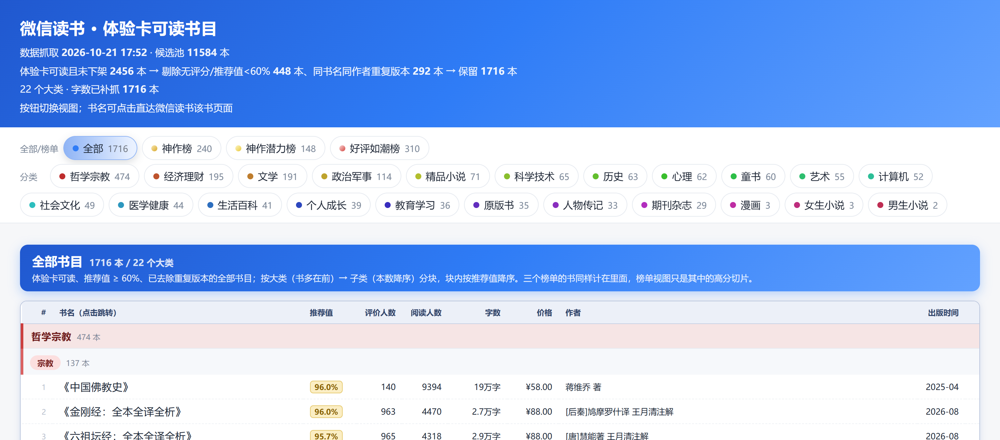
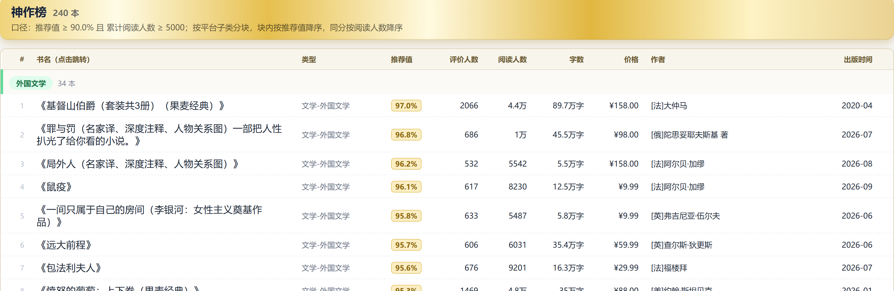
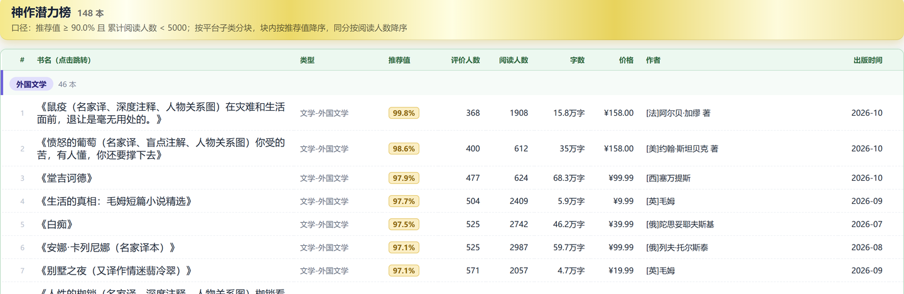
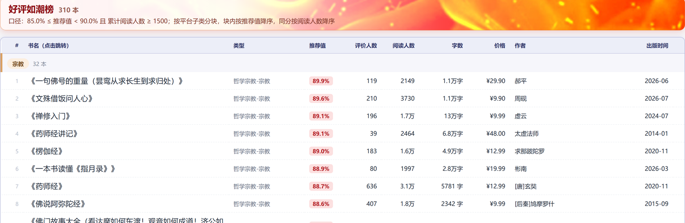

# weread-trial-card-list

**把微信读书「体验卡能免费读」的高分书，一次性整理成可筛选、可分享的书单。**

抓取微信读书公开的分类页与榜单页，筛掉低分与下架书、合并同书的不同版本，输出一份**单文件 HTML 报告**（全部 / 三大榜单 / 各大类一键切换）和一份 **Excel 清单**。一次实测产出：1716 本、22 个大类、3 个榜单。

原生支持 **Agent Skill** 协议：装进 WorkBuddy、Claude Code 等客户端后，说一句「体验卡能读哪些书」就能跑完全程。


---

> ### 卷首
>
> 自春来、惨绿愁红，芳心是事可可。<br>
> 日上花梢，莺穿柳带，犹压香衾卧。<br>
> 暖酥消、腻云亸，终日厌厌倦梳裹。<br>
> 无那。恨薄情一去，音书无个。<br>
> 早知恁么，悔当初、不把雕鞍锁。<br>
> 向鸡窗，只与蛮笺象管，拘束教吟课。<br>
> 镇相随、莫抛躲，针线闲拈伴伊坐。<br>
> 和我。免使年少，光阴虚过。
>
> <sub>—— 柳耆卿《定风波·自春来惨绿愁红》</sub>

柳耆卿此词，所写人间憾事，莫过于相逢当下而不知珍重；一朝别去，万唤难回。人情大抵如是，读书亦然。

此编陈于君前，便是相逢之顷。可读之时，若漫然轻放，以为来日方长；迨时移事改，卡片期满、书目轮替，向之可读者今已不可复得，便如词中所言，空自追悔，无复相随之期。

尤可叹者，词中一「悔」字，不在别离之后，而在「早知恁么」四字——当日若肯把雕鞍锁住，何至有今日之恨。体验卡亦有期，可读之书亦有限；趁其可读而读之，方不辜负这场相逢。阅者宜惜此机缘，莫待错过之后，徒增怅惘。闲话少叙，且看下文。

---



> **同系列技能**：如果你想解决的是「我书架上这些书该买哪些、书币怎么花、哪些快下架」，
> 用 [weread-buybooks](https://github.com/C-s-salute/weread-buybooks)；
> 它管你的书架，本技能管**全平台有哪些书用体验卡就能免费读**。两者数据源不同，可以配合使用。

## 解决什么问题

- **体验卡能读什么，平台不给你一张完整清单。** 分类页一页 20 本、榜单只给 Top N，翻完十几个分类仍然拼不出全貌。
- **高分书混在低分书里。** 一折促销、经典公版、冷门学术混排，人工逐本看推荐值和阅读人数极其耗时。
- **同一本书有多个版本。** 译本、注译本、全集与单册、期刊分期重复出现，手动去重容易漏。
- **报告不好分享。** 本工具输出的 HTML 是单文件，双击即开，可直接发给朋友或放进群聊。

## 适合谁

- **体验卡用户**：想知道这张卡到底能读哪些值回票价的书。
- **书荒 / 选书的人**：想按「神作 / 潜力 / 好评」三档直接抄作业。
- **读书社群运营**：需要一份可分享、可标注抓取时间的书单。
- **数据整理党**：想要 Excel 里可排序、可筛选、带超链接的原始清单。
- **Agent / Skill 玩家**：希望把「抓取 → 清洗 → 出报告」固化成一个可复用流程。

## 效果预览

**神作榜**：推荐值 ≥ 90% 且累计阅读人数 ≥ 5000，鎏金卡片 + 类型列。



**神作潜力榜**：推荐值 ≥ 90% 但阅读人数 < 5000，香槟金卡片，适合提前埋伏。



**好评如潮榜**：推荐值 85%~90% 且阅读人数 ≥ 1500，火焰卡片，口碑稳但还没出圈。



> 每张卡片下按子分类分块，块内按推荐值降序，同分再按累计阅读人数降序；书名为楷体书名号超链接，可直接跳到微信读书书籍页。

## 安装

### 方式一：命令行（推荐，便于更新）

```bash
git clone https://github.com/C-s-salute/weread-trial-card-list.git
cd weread-trial-card-list
pip install -r requirements.txt
python scripts/login.py        # 微信扫码登录
```

要求 Python 3.10+，本机已安装 Microsoft Edge 或 Google Chrome（没有则回退 Playwright 内置 chromium，需先执行 `playwright install chromium`）。

### 方式二：Release 包（无需 Git）

1. 打开仓库的 Releases 页面，下载最新 `weread-trial-card-list-vX.Y.Z.zip`。
2. 解压到任意目录（例如 `D:\tools\weread-trial-card-list`）。
3. 在该目录执行：

```bash
pip install -r requirements.txt
python scripts/login.py
python scripts/run_pipeline.py
```

Release 包与仓库内容一致，只是免去 clone；升级时覆盖解压即可，登录态存在用户主目录，不会丢。

### 方式三：在 WorkBuddy 里对话式安装（以 WorkBuddy 为例）

把 skill 当普通文件下载后，直接让 WorkBuddy 帮你装进它的全局 skill 目录，不用记路径。

**第 1 步：拿到 skill 目录**

- 下载 Release 压缩包并解压，或 `git clone` 到本地，记住这个目录（里面应有 `SKILL.md`）。

**第 2 步：在 WorkBuddy 新建对话，发送安装指令**

```text
请把本地目录 D:\tools\weread-trial-card-list 安装为全局 skill。
这个目录里已经有 SKILL.md，安装后请确认 name 与目录名一致。
```

如果你把仓库推到了 GitHub，也可以直接给链接：

```text
请安装这个 skill：https://github.com/C-s-salute/weread-trial-card-list
```

**第 3 步：按提示授权并确认**

WorkBuddy 会把目录复制到用户级 skill 目录（`~/.workbuddy/skills/`，Windows 下即 `C:\Users\<你的用户名>\.workbuddy\skills\`），必要时请求文件访问权限；安装完成后让它列出 skill 名称核对。

**第 4 步：直接用自然语言触发**

```text
用 weread-trial-card-list 帮我生成一份体验卡可读书目报告。
先检查登录态，没有登录就打开浏览器让我扫码。
```

后续想刷新数据只需要说：

```text
重新抓一次体验卡可读书目，重点分类抓全子分类，完成后把 HTML 和 Excel 路径发我。
```

## 快速开始

```bash
python scripts/login.py            # 1. 扫码登录（登录态只存本地 profile）
python scripts/fetch_pool.py       # 2. 抓分类与榜单
python scripts/fetch_extra.py      # 3. 补抓字数等详情
python scripts/fetch_readcount.py  # 4. 补抓累计阅读人数
python scripts/build_html.py       # 5. 生成单文件 HTML
python scripts/build_excel.py      # 6. 生成 Excel
```

或一条命令跑完（`--reuse` 跳过抓取，用缓存重出报告）：

```bash
python scripts/run_pipeline.py
python scripts/run_pipeline.py --reuse
```

全量抓取 + 逐本补抓耗时以小时计，中途中断后重跑会跳过已完成的记录。

## 输出

默认目录 `~/.weread-trial-card-list/data`：

| 文件 | 说明 |
|---|---|
| `微信读书_体验卡可读高分书.html` | 单文件报告，可离线打开或直接分享 |
| `微信读书_体验卡可读高分书.xlsx` | 概览、三大榜单、全部书目、分类汇总共 6 个 sheet |
| `_discover_pool.json` | 候选池缓存（权益、分类、链接） |
| `_book_extra.json` | 字数 / ISBN 等详情缓存 |
| `_book_read.json` | 累计阅读人数缓存 |

## 目录结构与文件作用

```text
weread-trial-card-list/
├── SKILL.md                 # Agent skill 说明：触发词、流程、口径、验收
├── README.md                # 本文件
├── LICENSE                  # MIT
├── requirements.txt         # 依赖下限：playwright、openpyxl
├── requirements-lock.txt    # 实测通过的精确版本
├── .gitattributes           # 统一换行符，避免 Windows 假 diff
├── .gitignore               # 排除登录态、缓存、报告产物
├── assets/                  # README 用的报告截图
├── references/
│   └── api-notes.md         # 接口、权益字段、口径与已知坑
└── scripts/
    ├── wrconfig.py          # 路径 / profile / 浏览器通道配置
    ├── login.py             # 扫码登录，写入持久化 profile
    ├── fetch_pool.py        # 分类与榜单列表抓取
    ├── fetch_extra.py       # 字数等详情补抓
    ├── fetch_readcount.py   # 累计阅读人数补抓
    ├── build_html.py        # 过滤、去重、单文件 HTML
    ├── build_excel.py       # 与 HTML 同口径的 Excel
    └── run_pipeline.py      # 串联执行入口
```

## 配置

全部通过环境变量控制，脚本内没有写死的路径。

| 变量 | 默认 | 说明 |
|---|---|---|
| `WEREAD_WORK` | `~/.weread-trial-card-list/data` | 数据与报告目录 |
| `WEREAD_PROFILE` | `~/.weread-trial-card-list/profile` | 浏览器 profile（登录态） |
| `WEREAD_BROWSER` | `msedge` → `chrome` → chromium | 浏览器通道 |
| `PER_CAT` | `300` | 普通分类每类抓取上限 |
| `DEEP_LIMIT` | `480` | 重点分类/子分类上限（接口上限） |
| `DEEP_CATS` | `1100000,1500000,600000,1200000` | 叠加子分类抓取的重点分类 ID |
| `SLEEP` | `0.3` | 请求间隔（秒），不建议调成 0 |
| `WEREAD_FIRE_IMAGE` | 空 | 可选的好评如潮榜卡片底图，缺省用 CSS 斜纹 |

## 筛选口径

1. **体验卡可读**：`payingStatus=1`；`paid=1` 永久可读、`payingStatus=2` 付费会员卡单独标注，不进入清单。
2. **评分门槛**：推荐值 = `newRating / 10`；剔除无评价人数与 < 60% 的书，保留有评分的样本。
3. **去重**：书名核心（去括注与标点）+ 作者关键词交集，保留评分最高的版本；分卷与期刊期号不合并。
4. **阅读人数**：使用书籍分享页的 `readingStat.readingCount`，不用列表接口的短期 `readingCount`。
5. **榜单**：神作榜（≥90% 且 ≥5000）、神作潜力榜（≥90% 且 <5000）、好评如潮榜（85%~90% 且 ≥1500）。

## 合规与免责

- 仅访问公开的分类页、榜单页、书籍详情与分享页，**不绕过付费、不抓正文、不下载书籍资源**。
- 登录只走微信扫码，cookie 持久化在本地 profile 目录，不导出、不打印、不提交；脚本不读取书架与个人账号数据。
- 默认数据目录位于用户主目录，`.gitignore` 已排除登录态、缓存 JSON 与报告产物。
- 请保留请求间隔（`SLEEP` ≥ 0.3s），不要高频抓取；抓取结果仅供个人研究参考，请勿转载或再分发原始数据。
- 体验卡权益与榜单规则由平台决定且会变化，报告只是抓取时刻的快照；本项目与腾讯 / 微信读书无关联。

## License

[MIT](LICENSE)
